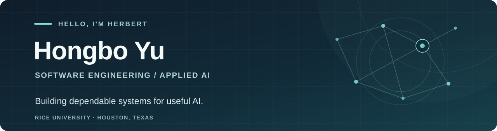

  

  <a href="https://g1lollipop.github.io/"><strong>Portfolio</strong></a> &nbsp;·&nbsp;
  <a href="https://www.linkedin.com/in/herbert-yu-rice/"><strong>LinkedIn</strong></a> &nbsp;·&nbsp;
  <a href="mailto:hy75@rice.edu"><strong>Email</strong></a>

### Hi, I'm Herbert 👋

I'm a Master of Computer Science student at Rice University. I enjoy building dependable backend systems and AI applications — from recoverable agent workflows and distributed scheduling to retrieval-powered products.

I'm seeking software engineering and AI engineering internships in the U.S. and expect to graduate in December 2027.

## Selected work

### [Atlas](https://github.com/G1lollipop/atlas) · Distributed systems

Atlas is a Go job scheduler for heterogeneous CPU and GPU workloads. Starting from a Taskflow snapshot, I extended it with resource-aware placement, worker leases, recovery, and tracing. In local tests with simulated handlers, median whole-batch throughput increased from 25.0 jobs/s with one worker to 88.6 with eight.

`Go` · `PostgreSQL` · `OpenTelemetry` · `Kubernetes`

[Architecture](https://github.com/G1lollipop/atlas/blob/main/docs/ARCHITECTURE.md) · [Benchmarks and limitations](https://github.com/G1lollipop/atlas/blob/main/docs/BENCHMARKS.md) · [Recovery tests](https://github.com/G1lollipop/atlas/blob/main/docs/CHAOS.md)

### [FitCore](https://github.com/G1lollipop/fitcore) · Applied AI

FitCore is a fitness and nutrition platform that makes food logging easier through text, voice transcripts, and photos. Its coaching experience uses hybrid retrieval — combining vector search and BM25, with optional reranking — to bring relevant context into answers.

`Next.js` · `FastAPI` · `Supabase` · `RAG`

[Explore the code](https://github.com/G1lollipop/fitcore) · [Try the live app](https://fitcore-web-eight.vercel.app/) (sign-in required)

## Open source

I'm also interested in making AI infrastructure more reliable. These pull requests propose fixes with regression coverage:

- **[LiteLLM #47053](https://github.com/BerriAI/litellm/pull/47053):** Make Enterprise permission rejections clearer for API users.
- **[DeepEval #3478](https://github.com/confident-ai/deepeval/pull/3478):** Preserve voice fields when exporting conversation datasets.

## My toolkit

**Languages:** Go, Python, Java, TypeScript, SQL  
**Backend & infrastructure:** FastAPI, Spring Boot, PostgreSQL, Redis, Docker, Kubernetes  
**AI & retrieval:** LangGraph, LangSmith, RAG, pgvector

More about my experience and projects on my [portfolio](https://g1lollipop.github.io/). If you'd like to connect, reach me at [hy75@rice.edu](mailto:hy75@rice.edu).
